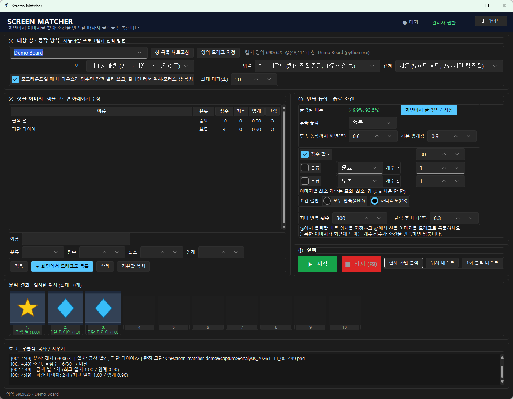
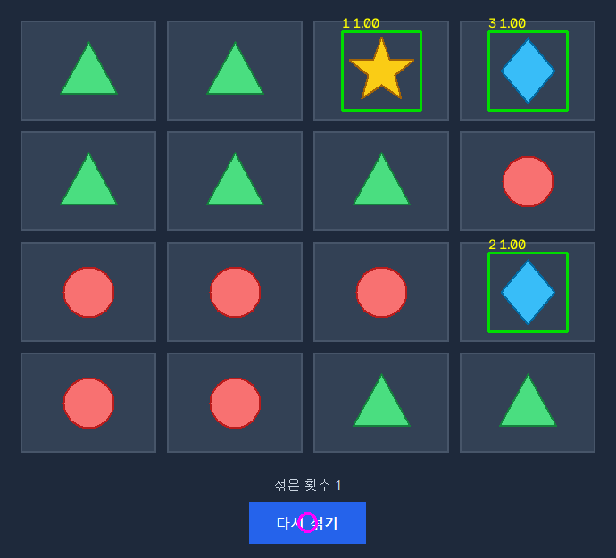

# Screen Matcher

화면에서 **등록한 이미지를 찾아, 조건을 만족할 때까지 지정한 클릭·키 입력을 반복**하는 Windows 도구입니다. 조건을 만족하면 알림음을 내고 멈춘 뒤 그때 화면을 저장합니다.

혼자 쓰려고 만들었다가, 어떤 창에서든 쓸 수 있게 정리해 공개합니다. 버튼 위치와 찾을 이미지는 화면에서 찍어 등록하므로 코드를 고칠 필요가 없습니다.

## 구현 포인트

- **2단계 템플릿 매칭**: 큰 화면에서는 절반 해상도에서 후보 위치만 고르고, 후보 주변만 원본 해상도로 다시 대조합니다. 최종 점수는 원본 해상도에서 계산하므로 결과는 전체 대조와 같고, 시간은 약 1/4입니다. 겹치는 검출은 NMS로 하나만 남깁니다.
- **해상도·화면 비율 정규화**: 클릭 위치는 창 크기 비율로, 이미지는 등록할 때의 창 크기와 함께 저장합니다. 화면 비율이 바뀌면(16:9 → 21:9, 16:10 등) UI가 높이에 맞춰 커지고 가운데 정렬된다고 보고 보정합니다. 이미지는 폭 기준·높이 기준 배율을 둘 다 시도해 더 잘 맞는 쪽을 씁니다.
- **입력·캡처 방식 자동 선택**: 대상 창에 메시지를 보내는 방식(PostMessage)을 먼저 쓰고, 반응이 없으면 실제 입력(SendInput)으로 바꿉니다. 캡처는 창이 보이면 화면을 읽고, 가려졌을 때만 창을 직접 캡처(PrintWindow)해 깜빡임을 줄입니다.
- **플러그인 구조**: 특정 화면 전용 판정 로직은 `presets/` 플러그인으로 분리했습니다. 코어는 범용 이미지 매칭만으로 동작합니다.
- **회차별 시간 계측**: 한 회차를 분석 · 입력 대기 · 동작 · 결과 대기로 나눠 로그에 남겨, 병목이 어디인지 바로 보입니다.

## 화면

Windows 11 스타일 테마를 씁니다(다크/라이트는 오른쪽 위 버튼으로 전환). 화면은 ① 대상 창·동작 방식 → ② 찾을 이미지 → ③ 반복 동작·종료 조건 → ④ 실행, 네 장의 카드로 나뉘고, 아래에 분석 결과 썸네일과 로그가 있습니다. 위젯에 마우스를 올리면 설명이 뜨고, 헤더 오른쪽에 실행 상태(대기 / 실행 중 N회 / 달성)가 표시됩니다.

위 화면은 도형 카드가 무작위로 섞이는 데모 창을 대상으로 한 예시입니다. '금색 별'(10점)과 '파란 다이아'(3점)를 등록하고 '현재 화면 분석'을 누른 상태입니다. 아래는 이때 `captures/`에 저장된 판정 그림입니다. 일치한 위치는 초록 상자와 일치 점수로, 반복해서 누를 버튼 위치는 분홍 원으로 표시됩니다.

## 파일 구성

| 파일 | 내용 |
|---|---|
| `screen_matcher.py` | 프로그램 전체 (GUI, 이미지 매칭, 입력·캡처) |
| `assets/` | 기본 설정(`default_cfg.json`). exe 안에 포함됨 |
| `requirements.txt` | numpy, opencv-python-headless, mss, sv-ttk(테마), pyinstaller |
| `build.bat` | 더블클릭 한 번으로 `dist\ScreenMatcher.exe` 생성 |
| `run.bat` | 소스로 바로 실행 (처음 한 번 패키지 설치) |
| `settings.json` | 실행 시 자동 생성. 대상 창·입력 방식·조건·등록한 이미지 목록 저장 |
| `icons/` | 등록한 이미지 (자동 생성) |
| `captures/` | 분석 결과·조건 달성 시 저장되는 화면 (자동 생성) |

## 빌드 / 실행

1. Python 3.10 이상을 설치합니다. 설치할 때 "Add python.exe to PATH"를 체크하세요.
2. `build.bat`을 실행하면 `dist\ScreenMatcher.exe`가 생깁니다(약 60~80MB). exe 하나만 복사하면 파이썬이 없는 PC에서도 실행됩니다.
3. 소스로 바로 실행하려면 `run.bat`을 씁니다. 스마트 앱 컨트롤이 서명 없는 exe를 막는 PC에서는 이 방법을 쓰세요.

exe는 실행할 때 관리자 권한을 요청합니다. Windows는 일반 권한 프로세스가 관리자 권한 창에 입력을 보내지 못하게 막기 때문입니다(UIPI).

## 사용 순서

1. **① 대상 창**: 목록에서 프로그램 창을 고릅니다. 제목이 바뀌어도 부분 일치·실행 파일명으로 다시 찾습니다. 창이 안 잡히면 '주 모니터 전체'나 '영역 드래그 지정'을 쓰세요. 입력·캡처 방식은 '자동'으로 두면 됩니다.
2. **② 찾을 이미지**: '화면에서 드래그로 등록'을 누르고, 스냅샷에서 찾을 그림을 드래그로 감쌉니다. 이름·분류·점수·최소 개수·임계값을 넣습니다. 여러 개 등록할 수 있습니다.
   - 배경 없이 그림만 꽉 차게 감쌀수록 잘 찾습니다. 12px보다 작으면 엉뚱한 곳이 잡힙니다.
3. **현재 화면 분석**: 등록한 이미지가 몇 개 잡히는지, 최고 일치 점수가 얼마인지 로그에 나오고, 판정 그림이 `captures/analysis_*.png`로 저장됩니다. 엉뚱한 곳이 잡히면 임계값을 올리고(기본 0.80), 못 찾으면 내립니다.
4. **③ 반복 동작**: '화면에서 클릭으로 지정'을 누르면 대상 화면 스냅샷이 뜹니다. 반복해서 누를 버튼을 클릭합니다. 버튼을 누른 뒤 확인창이 뜨는 프로그램이면 후속 동작을 Enter 키나 위치 클릭으로 정하고 지연 시간을 넣습니다.
5. **③ 종료 조건**: 점수 합 ≥ N, 분류별 개수 ≥ N(분류는 자유롭게 입력), 이미지별 최소 개수(표의 '최소' 칸)를 AND/OR로 묶습니다. 최대 반복 횟수와 동작 후 대기 시간도 정합니다.
6. **1회 클릭 테스트**: 동작을 한 번만 실행하고, 화면이 바뀌었는지 알려 줍니다. 안 바뀌면 입력 방식을 '포그라운드'로 바꾸거나 관리자 권한으로 실행하세요.
7. **④ ▶ 시작**: 3초 뒤 반복을 시작합니다. **F9**나 '■ 정지'로 언제든 멈춥니다. 조건을 만족하면 알림음과 함께 멈추고 `captures/success_*.png`를 저장합니다.

## 입력 / 캡처 방식

| 입력 방식 | 동작 |
|---|---|
| **자동** (기본) | 백그라운드로 시작하고, 대상이 두 번 연속 반응하지 않으면 포그라운드로 전환 |
| **백그라운드** | 대상 창에 클릭·키 메시지를 직접 보냄(PostMessage). 커서와 포커스를 바꾸지 않아, 실행 중에도 다른 작업을 할 수 있음. 하드웨어 입력만 받는 프로그램(DirectInput/RawInput 등)은 반응하지 않음 |
| **포그라운드** | 실제 마우스·키보드 입력(SendInput). 사용자가 마우스를 움직이는 중이면 멈출 때까지 기다렸다가(상한은 ①의 '최대 대기', 기본 1초) 대상 창을 앞으로 가져와 클릭하고, 커서 위치와 원래 포커스 창을 되돌림. 관리자 권한이면 그 짧은 동안 입력을 잠가(BlockInput) 클릭이 엇나가지 않게 함 |

| 캡처 방식 | 동작 |
|---|---|
| **자동** (기본) | 대상 창이 가려져 있지 않으면 화면 캡처, 가려졌을 때만 창 직접 캡처. 창 직접이 검게 나오면 화면으로 전환 |
| **창 직접** | PrintWindow. 다른 창에 가려져 있어도 됨. 대상 창이 캡처마다 다시 그려져 깜빡일 수 있고, 독점 전체화면은 검게 나올 수 있음 |
| **화면** | 모니터 픽셀을 그대로 읽음(mss). 대상 창이 가려지면 안 됨 |

## 속도

회차 로그 끝에 직전 회차의 소요 시간이 단계별로 찍힙니다. 예: `4.1초 (분석 0.2 · 마우스 대기 0.1 · 클릭·확인 0.9 · 결과 대기 2.9)`

- **분석**: 위의 2단계 매칭에 걸린 시간입니다.
- **마우스 대기**: 포그라운드 입력에서 사용자 마우스가 멈추기를 기다린 시간입니다. ①의 '최대 대기(초)'로 상한을 정합니다(0이면 기다리지 않음).
- **결과 대기**: '동작 후 대기'에 더해, 화면이 두 번 연속 같아질 때까지 걸린 시간입니다. 대상 프로그램의 화면 전환 시간이 대부분을 차지합니다. '동작 후 대기'를 줄이면 빨라지지만, 화면이 바뀌기 전의 이전 화면을 읽을 수 있으니 조금씩 낮춰 보세요.

## 오래 돌릴 때

- 실행 중에는 Windows의 디스플레이 끄기와 절전을 막고, 멈추면 원래대로 돌려 놓습니다.
- 화면 잠금(Win+L)은 캡처와 입력을 막으니 잠그지 마세요.
- HDMI로 연결한 모니터는 전원을 꺼도 대체로 괜찮습니다. DisplayPort는 전원을 끄면 연결 해제로 처리돼 창이 다른 화면으로 옮겨질 수 있으니, 밝기를 최소로 낮추는 쪽이 안전합니다.

## 문제 해결

| 증상 | 확인할 것 |
|---|---|
| 1회 클릭 테스트에서 화면 변화 없음 | 대상이 백그라운드 입력을 무시함 → 입력을 '포그라운드'로. 그래도 안 되면 관리자 권한으로 실행 |
| 백그라운드인데 마우스가 움직임 | 자동 모드가 포그라운드로 전환된 것. 로그에 전환 사유가 남음 |
| 포그라운드에서 커서는 복원되지만 입력 잠금이 안 됨 | BlockInput은 관리자 권한이 필요. 잠금 없이도 커서·포커스는 복원됨 |
| "마우스를 움직일 수 없습니다" | 대상은 관리자 권한인데 이 프로그램은 일반 권한임. '관리자 권한으로 다시 실행' |
| 엉뚱한 곳이 잡힘 / 못 찾음 | 표에서 행을 고르고 임계값 조정. 이미지를 배경 없이 그림만 꽉 차게 다시 등록 |
| 대상 창이 깜빡임 | 창 직접 캡처(PrintWindow) 때문. 대상 창을 다른 창으로 가리지 말거나, 캡처를 '화면'으로 |
| 캡처가 검게 나옴 | 대상 프로그램을 창 모드나 테두리 없는 창 모드로 |
| 창 목록에 대상이 없음 | '창 목록 새로고침'. 그래도 없으면 '영역 드래그 지정' |

## 확장: 프리셋 플러그인

`presets/` 폴더에 `Preset` 클래스를 가진 `.py` 파일을 두면, 모드 목록에 전용 모드가 추가됩니다. 특정 화면 구조를 아는 판정 로직을 넣고 싶을 때 씁니다. 인터페이스는 `screen_matcher.py`의 `load_presets()` 설명을 참고하세요. 폴더가 없으면 이미지 매칭 모드만으로 동작하고, `build.bat`은 폴더가 있을 때만 exe에 포함합니다.

## 사용 시 주의

이 도구는 다른 프로그램에 입력을 보냅니다. 자동 입력을 허용하지 않는 서비스(온라인 게임, 예매·구매 사이트 등)에는 쓰지 마세요.

## 라이선스

[MIT](LICENSE)
